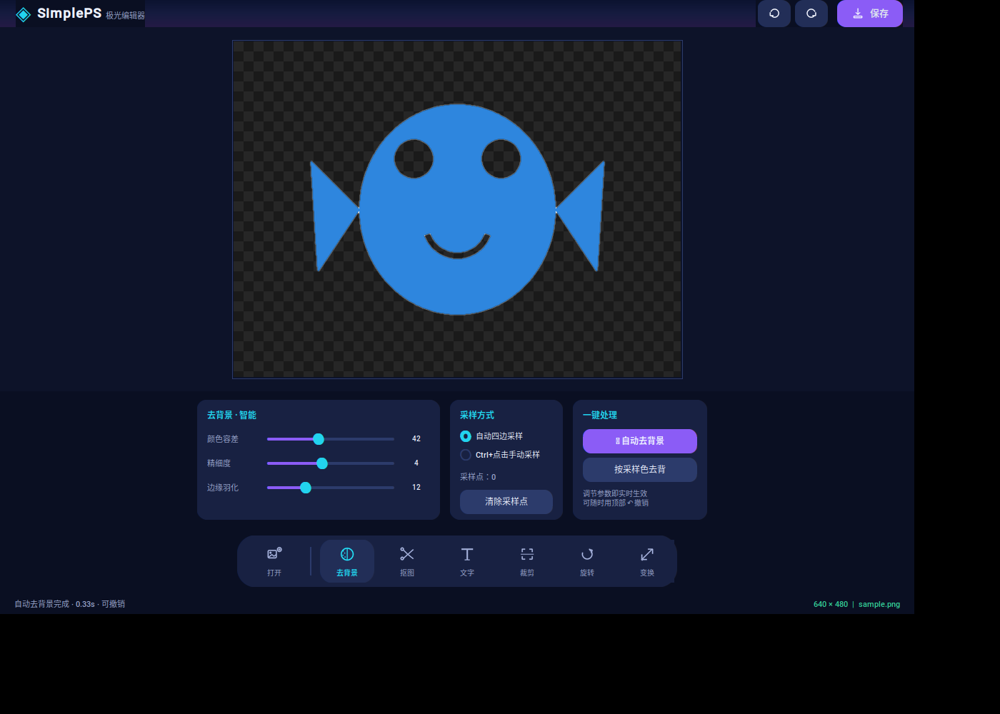

# SimplePS

> 现代化图像处理桌面工具：**去背景 / 抠图 / 字体模仿 / 图片编辑**，完全离线运行。v3.0 采用「极光」主题——深空蓝紫渐变 + 霓虹青紫粉强调色 + 玻璃拟态卡片 + 悬浮胶囊工具栏，手机修图 App 质感。

基于 Python + OpenCV + Pillow + customtkinter。提供 Windows 单文件 EXE（无需安装 Python），也可作为命令行工具批处理。



> v3.0 界面：极光渐变顶栏（◈ 品牌标识 + ↶ 撤销 / ↷ 重做 / 保存）+ 全屏棋盘格画布 + 居中玻璃选项卡片 + 底部悬浮胶囊工具栏（选中项青色高亮发光）。**没有图片时，直接点击画布中央的霓虹「＋」圆环即可选图**。空状态见 `examples/v3_empty.png`。

### v3.0 亮点

- **界面焕新**：从原生 tkinter 升级到 customtkinter，"极光"设计语言，圆角卡片 / 渐变 / 程序化矢量图标，真正像手机修图 App。
- **去背景快 6~8 倍**：GrabCut 与颜色距离改在缩略图（最长边 1024）上计算再放大还原，一张 600 万像素照片从 ~5.3s 降到 ~0.65s，画质无损。
- **去掉"应用"按钮，即时生效**：调节参数或框选/涂抹完成后自动处理，撤销栈保护每一步。裁剪、旋转、缩放松开即定稿。

---

## 功能

| 功能 | 说明 |
|---|---|
| 自动去背景 | 自动采样画面边缘颜色并用 GrabCut 精修，适合绝大多数主体/背景有色差的图片 |
| 按颜色去背景 | 取四角或手动采样点，按 Lab 颜色距离抠除纯色/渐变背景，边缘带羽化 |
| 矩形 / 笔刷抠图 | 拖拽框选主体或绿/红笔刷标记后 GrabCut 精细分割 |
| **智能字体模仿** | 框选图片中的一行文字 → 自动识别其**字体 / 字号 / 倾斜角 / 颜色** → 输入新文字，点击图片任意位置合成 |
| 手写模仿 | 逐字旋转抖动的毛笔手写风格，支持描边、阴影、渐变、多行 |
| **图片变换** | 缩放（比例 / 指定尺寸）、任意角度旋转、90° 步进、水平/垂直翻转、矩形裁剪 |
| 画布交互 | 滚轮缩放、中键拖拽平移、棋盘格透明背景显示 |
| 通用 | 打开/保存、PNG 透明通道、撤销/重做、Ctrl+O / Ctrl+S / Ctrl+Z 快捷键 |

### 字体模仿怎么用

1. 切到「字体模仿」Tab，点 **框选参考文字区域**，在图片上拖出图中那一行文字。
2. 在「图中文字内容」里输入图片上写的是什么（用于更准的字体匹配），点 **分析样式**。
3. 系统会识别出字体、字号、倾斜角与颜色（可手动微调）。
4. 输入你想生成的新文字，点 **在图片上点击选择位置**，再点 **合成到图片**。
5. 不满意可 Ctrl+Z 撤销重来。也可直接 **导出文字为 PNG**。

---

## 下载 Windows EXE

- 仓库地址：<https://github.com/haoliying/SimplePS>
- 已构建好的 EXE：<https://github.com/haoliying/SimplePS/releases/tag/v3.0.0>（`SimplePS.exe` 与 `SimplePS-cli.exe`）

也可以进入仓库 **Actions** → **Build Windows EXE** → 点击最新一次成功运行，在 **Artifacts** 中下载 `SimplePS-Windows.zip`。

也可以给仓库打一个 `v*` 标签（例如 `v1.0.0`），CI 会自动构建并把 EXE 发布到 Releases：

```bash
git tag v1.0.0 && git push origin v1.0.0
```

解压后可得到：

- `SimplePS.exe` —— 图形界面版
- `SimplePS-cli.exe` —— 命令行版

---

## 本地运行

```bash
python -m pip install -r requirements.txt
python main.py                 # 启动图形界面
```

命令行模式：

```bash
# 自动去背景
python main.py -i examples/sample.png -o out.png --mode auto

# 按颜色去背景（自定义采样点）
python main.py -i photo.jpg -o cut.png --mode color --samples 0:0;639:0

# 矩形抠图
python main.py -i photo.jpg -o cut.png --mode rect --rect 80,40,160,170

# 文字渲染 / 手写模仿
python main.py --mode text --text "你好 SimplePS" --size 72 -o text.png
python main.py --mode hand --text "Hello 世界" --seed 8 -o hand.png

# 模仿图片中的文字样式并合成新文字（框选区域 x,y,w,h）
python main.py -i photo.png -o out.png --mode imitate --rect 40,30,300,90 \
    --ref-text "参考文字" --text "新文字" --pos 200,300

# 图片变换：缩放 / 旋转 / 裁剪 / 翻转
python main.py -i photo.png -o out.png --mode resize --scale 0.5
python main.py -i photo.png -o out.png --mode resize --width 400
python main.py -i photo.png -o out.png --mode rotate --rotate 30
python main.py -i photo.png -o out.png --mode crop --rect 0,0,400,300
python main.py -i photo.png -o out.png --mode flip --flip horizontal

# 查看系统字体
python main.py --list-fonts
```

常用参数：`--tolerance`（颜色容差）、`--iterations`（GrabCut 迭代）、`--feather`（羽化）、`--font` / `--font-name`（字体）、`--color`（如 `255,0,0,255`）、`--jitter` / `--angle`（手写抖动）、`--ref-text` / `--pos`（字体模仿）。

---

## 自己打包 EXE

在 Windows 上执行：

```bat
build_windows.bat
```

脚本会安装依赖并生成 `dist\SimplePS.exe` 与 `dist\SimplePS-cli.exe`。等价于：

```bat
pyinstaller --clean --noconfirm SimplePS.spec
pyinstaller --clean --noconfirm SimplePS_CLI.spec
```

---

## 项目结构

```
SimplePS/
├── main.py                  # 入口（无参数 = GUI，有参数 = CLI）
├── simpleps/
│   ├── app.py               # tkinter 图形界面
│   ├── cli.py               # 命令行参数与流程
│   ├── utils.py             # PIL / NumPy / OpenCV 转换
│   └── core/
│       ├── background.py    # 去背景
│       ├── cutout.py        # 抠图
│       └── typography.py    # 字体渲染与手写模仿
├── tests/                   # 单元测试
├── assets/                  # 图标
├── examples/sample.png      # 示例图片
├── SimplePS.spec            # GUI EXE 打包配置
├── SimplePS_CLI.spec        # CLI EXE 打包配置
└── .github/workflows/       # 自动构建与发布
```

---

## 说明

- 去背景/抠图基于传统视觉算法，**无需下载模型**，离线可用；对边缘复杂（毛发、透明物体）的图片建议配合笔刷微调。
- 导出请优先使用 **PNG** 以保留透明通道；JPEG/BMP 会自动合成白色背景。
- 中文字体优先使用系统自带的 Noto CJK / 微软雅黑 / 黑体等，可在「字体模仿」页下拉选择。

## License

MIT
